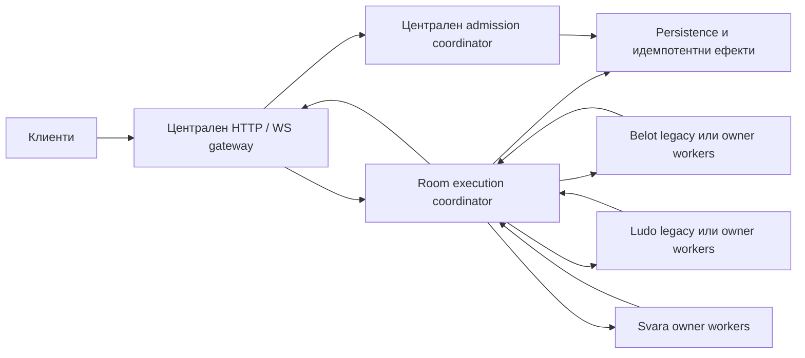

# Pika.bg — Етап 2Б.3.3Б: архитектура за многоядрено изпълнение

Дата: 16.10.2026. Проучен код: `2455221bfae8d52901c9d46d8389e6a283d73f7f`,
клон `v2-clean-architecture`. Това е проектен отчет; описаните бъдещи компоненти
не са реализирани. Пътищата и редовете по-долу са спрямо този commit.

## 1. Решение и граници на доказателствата

**Препоръка: централен WebSocket процес и разширяване на наличната
`worker_threads` инфраструктура с игрови адаптери и един собственик на маса.**
Първо Свара зад отделен флаг и с отделен ресурсен бюджет; после Ludo; Белот
се премества последен, без промяна на собственика на започната маса.
Това комбинира варианти А и Г. Не се препоръчва включване на PM2 cluster
върху сегашния сървър.

Наличната Belot инфраструктура действително може да изпълнява JavaScript
паралелно, но само в избрания режим и само за част от работата:

| Игра/режим днес | Къде се изпълняват правилата | Реален паралелизъм между маси |
| --- | --- | --- |
| Белот, липсващ флаг или `in-process` | Основната нишка; отделният thread пази shadow списък с идентификатори | Не за игровите изчисления |
| Белот, `worker-candidate` | Автоматичното развитие в pool; човешките команди в основната нишка | Да за tick изчисления върху различни workers; при count=1 няма два паралелни игрови workers |
| Ludo | Runtime, reducers, ботове и timeout callbacks в основната нишка | Не за игровия JavaScript |
| Свара | Синхронен runtime и engine в основната нишка | Не за игровия JavaScript |

**Не е доказано кой Belot режим работи в продукция.** Предоставеното наблюдение
„един PM2 процес, fork“ не отговаря на този въпрос: един процес може да има
много worker threads. Нямаме SSH/живи CPU измервания. Кодът по подразбиране
избира `in-process`; това не доказва, че продукционната среда не го override-ва.
Не е измерван текущият производствен капацитет и не се обещава брой маси/ядро.

Проучването включва source, persistence, recovery, monitoring и deploy скриптовете.
Изпълнени са Git проверки и четене на файлове; няма игрови тестове, build,
benchmark, миграция, SSH или деплой в този етап.

## 2. Белот: действителният път

### 2.1. Режими и worker lifecycle

- `server/src/index.ts:707`, `parseGameWorkerTickMode`: празна стойност означава
  `in-process`; единствената друга валидна стойност е `worker-candidate`.
  `BELOT_GAME_WORKER_COUNT` има default **1**, а
  `BELOT_GAME_WORKER_MAX_ROOMS_PER_WORKER` — **1000**; те не са CPU sizing оценка.
- `index.ts:26607`: в candidate режим се стартира `createGameWorkerPool`, който
  се подава на `createGameWorkerTickOrchestrator`. В другия режим се стартира
  един lifecycle worker и shadow synchronizer, но orchestrator използва
  `syncTickTarget: activeRoomRuntime` (`index.ts:26672`).
- `server/src/game/createGameWorkerLifecycleClient.ts:354` създава реален
  `new Worker(...)` от `node:worker_threads`.
  `resolveGameWorkerEntryUrl.ts:5` изисква компилирани `gameWorkerThread.js` и
  `workerProtocol.js` в `server/dist/game/`, проверява наличност и mtime спрямо
  съответния source. Това не е доказателство за еднакъв Git SHA на всички
  runtime зависимости при бъдещо смесване на версии.
- `gameWorkerThread.ts:37` пази `Set` от room IDs, а не постоянен авторитетен
  речник от пълни игри. `assign_room` добавя ID. При `compute_tick_rooms`
  получава **цял ServerRoom + baseRevision** за всяка маса и изчислява резултат
  върху полученото копие. Няма общ worker RPC за човешки команди/Ludo/Свара.
  `workerProtocol.ts:5` е Belot protocol version 4.

### 2.2. Какво се изпълнява паралелно

`createGameWorkerPool.ts`, `pickWorker` (`:249`) избира ready worker с най-малко
назначени маси, при равенство — по index, с лимит maxRooms. `ensureRoom` (`:390`)
пази стабилно назначение в `roomAssignments`; не премества жива маса при всеки tick.

`computeTickRooms` (`:605`) групира по worker и изпраща групите чрез
`Promise.all` (`:653`). Това е доказателството за едновременно изпълнение в
различни threads. **Вътре в един worker** `gameWorkerThread.ts:221` обхожда
масите със синхронен `for`; те се обработват последователно.

Изчислителният път е:

```text
main setInterval (250 ms) → tickRoomGameRuntimes → computeCandidates
  → pool.computeTickRooms → worker.compute_tick_rooms
  → advanceRoomAuthoritativeGame → advanceServerGameToNow
  → advanceOneServerStep → phase/timeout/bot transition
  → candidate + baseRevision → main validation/commit/persist/broadcast
```

`index.ts:510,26734` задава poll от 250 ms. `advanceServerGameToNow.ts:8,31`
ограничава catch-up до 256 стъпки. `advanceOneServerStep.ts:18` проверява
автоматични фази, cutting, bidding, playing и sweep timeout-и.
`advanceExpiredServerBiddingState.ts:39` извиква `pickServerBotBidAction`;
`advanceExpiredServerPlayingState.ts:120` — `pickServerBotPlayCard`.
Тези bot решения, автоматичните фазови преходи и вложените им игрови
изчисления могат да работят извън main в candidate режим. Самият poll,
подготовката на пълните състояния и приемането на резултатите остават в main.

Pool-ът чака всички групи преди връщане. Orchestrator има един общ in-flight
batch guard. Бавен worker може да забави целия batch и да пропусне следващи
poll-и; това още не осигурява независимо обслужване на всяка игра.

### 2.3. Човешки команди, състояние и ефекти

`index.ts:22547,22600,22682,22771,22877` обработва съответно bid/cut/play/sweep
през `activeRoomRuntime`. Името `createWorkerBackedActiveRoomRuntime` е подвеждащо,
ако се тълкува като пълно изнасяне: неговите `submitBid`, `submitCut`,
`submitPlay`, `submitSweepDecision` проверяват назначението, след което викат
**синхронния delegate**. `createInProcessActiveRoomRuntime.ts:84,100` извиква
`submitHumanBidActionForRoom`/`submitHumanPlayCardForRoom` и съответните правила
в основната нишка. Wrapper-ът в in-process tick също групира логически,
но изпълнява delegate групите последователно, без IPC.

Авторитетното състояние е `serverState.rooms` (`index.ts:4122`), revision registry
е в main, а `roomGameRuntimeRegistry` (`:4155`) пази локални runtime метаданни.
Worker assignment не е авторитетно притежаване на game state.

При IPC могат да пристигнат човешки ходове, докато се смята tick.
Orchestrator проверява `baseRevision` след отговора;
`applyAcceptedGameWorkerCandidate.ts:23` проверява отново преди commit.
Остарял кандидат се изхвърля. При успех функцията заменя canonical room,
записва snapshot, връща стария room при persistence грешка, увеличава revision,
публикува и извиква `onApplied`. Това е съществуваща защита срещу overwriting
на по-нов ход, не обща система за durable deduplication на всички команди/ефекти.

В main остават още authentication, room admission/matchmaking, reconnect/leave,
турнирна координация, икономика, progression/campaign ефекти, Belot journal,
DB операции и клиентска сериализация/fan-out. `index.ts:6138` показва worker
commit pipeline и ефектите му; `commitServerRoomWithSnapshot` (`:4005`) е
direct-command пътят. `core/broadcastRoomSnapshots.ts:32` строи отделен
`createRoomSnapshotMessage(room, seat)` за всеки човек и отделен spectator fan-out.

Белот вече има SQLite active-room snapshots:
`db/activeRoomSnapshotStore.ts:75,81,154` използва `DatabaseSync`, WAL и
`upsertRoom`. Следователно DB/JSON работа може да задържа main и след
изнасянето на tick. Архивната компресия (`diagnostics/belotHandJournal/
belotHandJournalCompression.ts`) ползва zlib/libuv или външен zstd процес;
това е отделен вид паралелна работа и не разпределя маси между ядра.

### 2.4. Сегашен срив и възстановяване

Lifecycle client маркира unexpected error/exit като failed и отказва pending
requests (`createGameWorkerLifecycleClient.ts:262,270`). Няма автоматичен
supervisor, който да пресъздава всеки failed bundle безкрайно.
`core/roomTickRecoveryPipeline.ts:189` освобождава assignment само за потвърден
неработещ worker и опитва `ensureRoom` от запазения **main** room върху ready
капацитет. При един умрял worker и липса на друг ready капацитет това не
създава нов worker. Има bounded recovery, quarantine и проверка за допустим
technical abort/refund; не всяка маса е допустима за автоматичен abort.
`roomTickHealthTracker.ts` пази отделни състояния за временен/постоянен refund
отказ. Тази икономическа политика не трябва да се копира механично в Свара.

## 3. Ludo: състояние, таймери и WebSocket

`index.ts:5404` създава `createLudoMatchRuntime` в main. Няма Ludo worker
entry point или worker dispatch в игровия път.

`game/ludoMatchRuntime.ts:174` държи `matches` и `profileToMatch` в собствената
инстанция. `roll`/`move` проверяват участник, ред и `expectedRevision`
(`validate`, `:334`); `applyRoll`/`applyMove` (`:295,324`) викат `reduceLudoGame`
синхронно. Dice anti-luck state също е част от server match, не клиентски state.

`scheduleDeadline` (`:197`) създава `setTimeout` в същата нишка: roll timeout
5 s, move 15 s, bot think 1.5 s. Callback проверява deadline/color/phase,
след това прави roll или `pickLudoBotMoveForState`. Това са таймери за
отложено изпълнение, а не паралелни threads. `commit` (`:274`) увеличава
revision, пренасрочва timer и синхронно извиква `options.onSnapshot`.

`index.ts:24512` вика runtime.roll/move/reclaim директно от WS handler.
`onSnapshot` (`:5405`) persist-ва, извършва идемпотентни settlement/progression
и други ефекти; `:5484` минава през `toLudoGameProtocolSnapshot`, после намира
текущите връзки по profile ID и праща персонални wallet/prize данни само на
съответния играч. Напусналите се изключват; spectator payload е отделен.

`db/activeLudoMatchSnapshotStore.ts` и startup restore (`index.ts:5629`) вече
пазят match snapshots в SQLite. `restoreMatch` (`ludoMatchRuntime.ts:416`)
възстановява game/dice/bot state без нов debit/random deal; таймерите се
насрочват с нов срок според сегашната фаза. Тази политика трябва да се запази
при бъдещо преместване. `Match` съдържа timer handles, Sets и connection IDs:
**самият runtime обект не може да се изпрати готов през IPC**. Нужни са
инстанция в worker и заменени callback-и с типизирани съобщения.

## 4. Свара: подходяща граница, оставащи липси

`games/svara/runtime/svaraMatchRuntime.ts:253` създава локален Map за инстанцията.
`executeParticipantCommand`/`executeSystemCommand` нормализират отделни
whitelist-и. Trusted actor идва от сървъра, а ID namespace-ите разделят
играч/системна команда (`:201,206`). `apply` (`:265`) синхронно извиква
`applySvaraMatchCommand` и заменя state само при успешен резултат; engine
пази обработените ID и отказва конфликтно повторно използване.

`createSvaraLobby.ts:18` инстанцира runtime в main. `handle` проверява live
session/feature/role, cross-game commitments и прилага командата без async
изчакване. Сега са изложени само lobby/create/join/leave/start/state команди;
няма внедрен пълен gameplay WS routing, автоматичен scheduler или persistence
за Свара. Disconnect премахва transport/subscription, а не мястото.

Engine/runtime нямат пряка зависимост от socket, authStore, DB или реални
баланси. **Да, могат да работят в същия тип worker_threads pool, като import-ват
съществуващите правила.** Не могат просто да се включат в сегашния Belot
`compute_tick_rooms`: типът там е `ServerRoom`, runtime state не живее в worker
и липсва generic command RPC. Нужен е отделен Svara adapter зад общ transport.

В main остават live authentication/ban/role/feature checks, връзките,
subscriptions, cross-game admission и турнирните/икономическите услуги.
Runtime state, command execution, игровите таймери и построяването на защитени
игрови payload-и принадлежат на owner worker в целевата архитектура.

Оптимизацията `2455221` намалява копирането на неизменяемите архиви, без да
премахва ledger/history/старите ID. Пълният ledger audit и shallow container
копията остават O(n). Предишното сравнение отчита 7.43×/10.39× ускорение за
конкретните прозорци; това не е production SLO и не е ново измерване тук.
Пълният JSON е ~1.07 MB при 2000 команди, затова изпращането му при всеки
ход през IPC би върнало част от цената. Подробности и валидиране:
[отчет 2Б.3.3А](../../docs/svara-engine-optimization-2b33a.md).

Споделянето на замразени записи е **в рамките на един isolate**. `postMessage`
клонира данните; engine WeakMap/WeakSet metadata не се пренасят. Затова state
трябва да остане при owner-а, а не да се връща постоянно като вход за нова команда.
`exportInternalStateForServer` прави пълен clone за изричен server export.
Текущият `SvaraMatchRuntime` API (`:161`) **няма restore/import операция**.
Engine работа с restored state не е равнозначна на готово runtime възстановяване.

Специална защита: snapshot протоколът използва module-local `builtSnapshots`
WeakSet (`protocol/svaraSnapshotProtocol.ts:206`), а serializer (`:368`) приема
само builder output. След structured clone този brand няма да е валиден в
друга нишка. Worker трябва да извика съществуващите builder **и serializer
локално**, след което да изпрати serialized payload с trusted recipient
metadata. Main не трябва да заобикаля проверката чрез произволен `JSON.stringify`.
Нужна е и проверка на получателя/версията на IPC envelope преди socket send.

## 5. Продукция и smart deploy

В проследените файлове не е намерен PM2 ecosystem файл, задаващ instances,
cluster mode или Belot worker flags. `server/.env.example` също не ги задава.
`index.ts:1` зарежда `dotenv/config`; действителната среда/`.env` и живият build
остават непроверени. Не се четат/публикуват production secrets.

`scripts/deploy-production.sh`, `classify_path`, избира frontend/backend
операциите по Git delta и deployment markers. Markdown файловете са non-runtime.
Backend скриптът компилира целия server в staging, активира dist и прави
**`pm2 restart belot-v2-server`**, не cluster reload. При pending migrations
има verified DB snapshot и stop на стария writer преди activation/migration.
Няма управление на отделен fleet от game processes или room handoff.

`shutdownServer` (`index.ts:27356`) блокира мутации, спира timers, чака
orchestrator, спира pool/lifecycle и затваря stores. Това е useful основа,
но не е безшевен WebSocket handoff. Рестартът прекъсва връзките; Свара още
няма durable restore. Не може да се обещае нулево прекъсване само с workers.

`/health` (`index.ts:21494`) връща `gameWorkerTick.mode`, lifecycle и подробен
`gameWorkerPool`. HTTP статусът е 200 дори когато вложени worker полета са
нездрави; pool top-level `state` не замества броя `readyWorkers/failedWorkers`.
За бъдещ rollout са нужни семантични readiness проверки, не само HTTP 200.

### Кратки read-only команди за собственика

Изпълняват се отделно на VPS, като текущия PM2 собственик. Не са изпълнявани
в този етап. Не изпращайте пълен `pm2 jlist`, `pm2 env`, `/proc/.../environ`
или `.env`: могат да съдържат секрети.

```bash
# CPU/ограничения и версия от shell (Node interpreter на PM2 може да е друг).
node --version
lscpu | head -n 20
getconf _NPROCESSORS_ONLN
cat /sys/fs/cgroup/cpu.max /sys/fs/cgroup/memory.max 2>/dev/null

# Само избрани технически полета от PM2; без пълен environment.
pm2 jlist | node -e 'let s="";process.stdin.on("data",x=>s+=x);process.stdin.on("end",()=>{for(const a of JSON.parse(s).filter(a=>a.name==="belot-v2-server")){const e=a.pm2_env||{};console.log(JSON.stringify({name:a.name,pid:a.pid,mode:e.exec_mode,instances:e.instances,status:e.status,cwd:e.pm_cwd,script:e.pm_exec_path,interpreter:e.exec_interpreter,node:e.node_version,restarts:e.restart_time,tickMode:e.BELOT_GAME_WORKER_TICK_MODE,workerCount:e.BELOT_GAME_WORKER_COUNT,maxRooms:e.BELOT_GAME_WORKER_MAX_ROOMS_PER_WORKER}));}})'

# Авторитетният effective режим е в живия health, включително dotenv override.
# 3001 е source default; ако действителният порт е друг, заменете го.
curl -fsS http://127.0.0.1:3001/health | node -e 'let s="";process.stdin.on("data",x=>s+=x);process.stdin.on("end",()=>{const h=JSON.parse(s);console.log(JSON.stringify({gameWorkerTick:h.gameWorkerTick,gameWorkerLifecycle:h.gameWorkerLifecycle,gameWorkerPool:h.gameWorkerPool,roomShadowSync:h.roomShadowSync},null,2));})'

# pid от горния филтриран PM2 резултат; повторете за всеки съвпадащ процес.
app_pid=12345
ps -L -p "$app_pid" -o pid,tid,psr,pcpu,stat,comm
# Само ако pidstat вече е инсталиран: кратка проба при обичайни активни маси.
pidstat -t -p "$app_pid" 1 5
```

Броят OS threads включва V8/libuv и не доказва броя game workers. PSR е
моментното ядро, `%CPU` в ps е усреднено; health доказва избрания път, а кратка
активна CPU проба показва реална работа. Нулево CPU при празни маси не отрича
възможността за паралелизъм. При cgroup v1/друг layout `cpu.max` може да липсва.

## 6. Сравнение на вариантите

Следващата оценка е проектна преценка за конкретния код. Node поддържа CPU
JavaScript в паралелни worker threads и препоръчва pool за повтарящи се задачи;
обикновените обекти се клонират през messages, не стават shared Maps.
[Node worker_threads](https://nodejs.org/docs/latest-v24.x/api/worker_threads.html).

| Критерий | А. Нов thread pool + централен WS | Б. Игрови child processes + IPC | В. PM2 cluster + room routing | Г. Разширяване на наличния pool |
| --- | --- | --- | --- | --- |
| CPU/ядра | Реален JS паралелизъм между workers | Реален паралелизъм между процеси | Реален паралелизъм между instances | Вече има Belot tick паралелизъм; разширяване за всички команди/игри |
| Main event loop | Разтоварва compute; clone/DB/fan-out остават риск | Същото при централен WS; IPC serialization остава | Разпределя и socket работа, но добавя междупроцесен routing | Сегашният batch barrier и човешки submit-и още блокират/забавят; трябва адаптация |
| RAM | Отделни isolates/heaps; обикновено по-нисък overhead от пълни сървърни процеси, без числова гаранция | Отделен runtime/heap на процес, по-висок очакван baseline | Дублира целия монолит, caches/stores/schedulers | Съществуващи heaps плюс нови адаптери; бюджет се мери, не се умножава count на сляпо |
| Сложност | Средна/висока: ownership, RPC, recovery | Висока: същите гаранции плюс supervisor и lifecycle | Най-висока тук: sockets, rooms, auth/cache и admissions между instances | Най-малък начален обхват; pool API не е готов generic actor API |
| Изолация на state | Owner isolate; не е security sandbox, общ процес | По-силна process crash изолация; достъпът до secrets пак се ограничава | Отделни процеси, но лесно два owners без coordinator | Сегашният main canonical + candidate модел се запазва за legacy; нов single-owner режим отделно |
| Последователност | Per-room mailbox, revision и dedupe | Същото, не следва автоматично от IPC | Същото плюс cross-instance ordering | Revision/stale checks са reusable; няма общ durable mailbox |
| Таймери/закъснения | При owner; един натоварен worker забавя своите маси | При owner процес; отделен event loop | Само owner instance; restart/route не бива да стартира втори timer | Преизползване на правила, но не общ глобален batch за всички игри |
| WS маршрутизация | Една централна socket registry | Същият централен gateway | Socket може да е в различен instance от room owner; нужен broker | Сегашният gateway остава; добавя се вътрешен command routing |
| Срив/рестарт | Supervisor, fencing, checkpoint/replay; process OOM/native crash може да засегне всички threads | По-добра граница при process failure; същата нужда от replay | PM2 рестартира процес, но не възстановява room ownership/ефекти | Има failure/reassignment/quarantine; липсва пълен stateful worker recovery |
| SQLite | Централна persistence услуга; без DB handle във всеки gameplay worker | Същото; много writers не решават write concurrency | Най-рисково със сегашните много sync stores и duplicated jobs | Запазва сегашните stores; Svara persistence се добавя отделно |
| Smart deploy | Близък до настоящия един PM2 app; нужен drain/checkpoint contract | Нужни child supervision, stop propagation и версии на всички child entry points | Настоящият single-app restart flow не дава room-aware rolling deploy | Най-близък; compiled entry/protocol/lifecycle вече съществуват |
| Риск за Белот/Ludo | Среден при едновременно пренаписване | Висок при нова инфраструктура за всичко | Много висок при директно включване | Най-нисък при нови Svara маси първо и legacy backend за старите игри |

`child_process.fork` създава отделен Node процес с IPC; вариант Б е резервен
избор, ако измерванията/изискванията изискат по-силна процесна изолация.
[Node child_process](https://nodejs.org/api/child_process.html).

Cluster разпределя connections, а не бизнес собственост на маси; Node не
осигурява room routing. Sticky connection също не събира различните играчи
от една маса в един owner. PM2 изисква изнасяне на локалното споделено state.
Сегашните Maps, queued players, sockets и турнирни jobs не отговарят на това.
[Node cluster](https://nodejs.org/api/cluster.html),
[PM2 cluster](https://pm2.keymetrics.io/docs/usage/cluster-mode/).

SQLite WAL позволява readers паралелно с writer, но има само един writer
в даден момент. Предложението е кратки транзакции и управлявана writer опашка;
worker на всяка маса с произволни sync writes би добавил contention.
[SQLite WAL concurrency](https://www.sqlite.org/wal.html#concurrency).

## 7. Целева архитектура: ownership, routing и безопасност

### 7.1. Компоненти и ресурсен бюджет



Това са логически компоненти, не предложение за отделен процес за всеки box.
Първоначално gateway/coordinators и съществуващите stores остават в main;
game rules и player projections работят в pool. Ако sync persistence стане
измерен bottleneck, отделен writer executor е следващ етап с transaction API,
а не прехвърляне на живи DB handles през IPC.

`RoomExecutionCoordinator` е единствен writer на
`(gameKind, roomId) → {backend, workerId, workerGeneration, roomEpoch, status,
lastCommittedSeq, stateVersion}`. Namespaced key предотвратява сблъсък между
Belot roomId и Ludo/Svara matchId. Локален coordinator Map е допустим в един
gateway, но не се представя като споделен между процеси. При бъдещи няколко
gateways registry/leases трябва да са отделна услуга или транзакционен store.

Има точно един mutable gameplay owner за новите worker маси. Main пази
committed checkpoint/read models и routing, без да прилага игрови правила
паралелно. Legacy Belot остава изрично друг backend с main canonical и
candidate ticks, докато бъде преместен като отделен етап.

Разпределяне: pin на масата при create, само към ready worker с капацитет;
първо least-loaded по room count с лимити, после отчетени queue depth,
CPU time и memory. Няма worker на ход, няма live rebalance в първия rollout.
Изборът на count следва реалните CPU quota/RAM и latency. При едно достъпно
ядро няма обещание за multicore ускорение. Резервира се капацитет за main/OS,
без отделните game pools всеки да си присвои всички ядра.

За изолация на игрите: отделни game worker бюджети или резервирани workers,
ограничени опашки на room/игра/профил, fair scheduling и backpressure. Един
общ FIFO worker за всички игри не изпълнява целта. JS compute не се прекъсва
магически от fairness; един дълъг ход блокира своя worker. Pool има глобален
CPU/RAM таван; на малък VPS изолацията е ограничена. Shared process OOM и
обща SQLite/WS опашка остават общи рискове.

### 7.2. Команда до резултат

1. Gateway парсва съществуващия публичен протокол, валидира live session,
   роли/feature/ban и извежда actor от удостоверената връзка. Не приема
   client playerId/seat/workerId като авторитетни.
2. При create/join се резервира commitment атомарно (§7.3), преди IPC.
   За обикновен ход coordinator намира backend/owner и нарежда команда.
3. Вътрешният envelope съдържа protocol/game/schema version, room key,
   worker generation + room epoch, command ID, server sequence, actor,
   expected state version при приложимост, validated payload и correlation ID.
   Session cookies/socket/DB handles не се предават.
4. Една per-room mailbox подрежда **всички** ходове, join/leave, reconnect,
   system timers и admin действия. Owner проверява epoch, membership, ред,
   revision и whitelist; изпълнява една команда до край преди следващата.
   Сървърният ред е редът на приемане от coordinator, не client часовникът.
5. Owner връща tagged result с seq/version, публична projection,
   отделни `{recipientProfileId, serializedSnapshot}` и typed effect intents.
   Не се праща raw authoritative state към браузъра. Checkpoint е отделен
   строго server-only канал, а не поле в generic client message.
6. Coordinator отхвърля грешни generation/epoch/seq/recipient резултати;
   изпълнява persistence/effect contract (§7.4). Само committed версия се
   публикува; worker не продължава напред с uncommitted state при DB отказ.
7. Gateway намира **текущата** разрешена връзка за профила, проверява достъпа
   отново при доставка и праща само неговия payload. Стар connection/session
   не получава отговор след displacement/logout. Public lobby и spectator
   broadcasts използват отделните whitelist projections.

Нужна е изрична семантика за две еднакви команди и за client retry с нов ID.
Server seq сам по себе си не разпознава логическо повторение с нов ID.
За Svara се запазват съществуващите actor/system ID namespaces и fingerprint
conflict проверки; за legacy протоколите се проверява какви version/ID
гаранции реално са възможни преди обещание за retry safety. Публичен protocol
change, ако се окаже необходим, се одобрява отделно, не се прикрива като IPC.

### 7.3. Атомарна cross-game защита

Сега `index.ts:4139,4149,5034,5046,6656` проверява main state/runtime/queues и
турнирния coordinator. Svara create/join и `createSvaraLobby.handle` са
синхронни; HTTP tournament guards са непосредствено преди mutation
(`:15390,15461,15567`). Това е една процесна граница, а не distributed lock.

След първото `await worker` проверка „свободен“ и по-късно „запиши място“
вече не са атомарни. **Задължителен преди async admission е централен
`GameAdmissionCoordinator`**, използван и от трите игри и турнирните входове:

- `reserve(profileIds, target, requestId)` проверява и записва pending
  резервациите в една синхронна critical section без await. За турнирна
  двойка се проверяват/резервират и двамата, в стабилен ред, all-or-none.
- Waiting rooms, matchmaking, guest/resume token ownership, active games и
  турнирни преходи използват една политика. Не се променя произволно дали
  обикновена бъдеща турнирна регистрация блокира игра; запазват се сегашните
  правила за active commitment и се описват всички takeover/transition пътища.
- Pending reservation блокира конкурентен Belot/Ludo/Svara/tournament вход.
  Owner успешен commit потвърждава reservation по token/version; доказан
  отказ я освобождава. Преход от waiting към active е transfer на същия
  commitment, без временно освобождаване.
- IPC timeout е **неизвестен резултат**, не отказ. Не се освобождава по TTL
  на сляпо: пита се owner/status journal или се fence-ва старият owner и
  възстановява последният commit. Worker exit не прави профила свободен.
- Освобождаване само от committed leave/finish/допустим abort и правилен
  reservation token. Late release от стар owner не изтрива нов commitment.
- При startup registry се възстановява от durable commitments/игри преди
  readiness; конфликт се карантинира. Нито един legacy admission път не
  остава със самостоятелна проверка, която заобикаля coordinator-а.

В един gateway това дава атомарност между различни game workers. При няколко
gateway процеса е нужен общ transactional arbiter с uniqueness/leases;
няколко еднакви mutable Maps не решават проблема. При бъдеща икономика
commitment reservation и debit/start трябва да имат една транзакционна
граница или изрично durable orchestration с идемпотентни операции.

### 7.4. Срещу двойни ходове, загубени събития и срив

IPC не дава exactly-once бизнес ефекти. Дори успешно `send` не означава
durable commit или доставка в браузъра. Нужни са durable command dedupe,
монотонна committed version и event/effect IDs. За пълната заявена гаранция:

- Командата води до tentative next state. Транзакция пази committed
  checkpoint/промяна, command outcome и event/effect outbox. При отказ worker
  връща предишната версия/спира до възстановяване; няма ack/broadcast преди commit.
- Случайността е server-owned. За replay се записват избраните карти/RNG
  резултати или готовият next-state checkpoint; забранено е повторно теглене
  след неопределен изход. История/processed IDs не се отрязват без отделен дизайн.
- След crash supervisor спира dispatch към всички засегнати маси, ограничава
  опашките и запазва commitments. Timeout сам не позволява втори owner.
  Старият worker се прекратява/потвърждава като излязъл или резултатите му
  се fence-ват с нов generation/epoch и durable commit проверки.
- Нов worker се създава с bounded retries/backoff; зарежда последния committed
  state, ID/outcomes, unresolved outbox, membership и timer policy. Pending
  command се reconciles по ID; не се изпълнява втори път на предположение.
  Едва след restore ack coordinator отваря mailbox и изпраща нов snapshot.
- При невъзстановим state масата е paused/quarantined; средствата и местата
  не се освобождават автоматично. Използва се одобрена за играта abort/refund
  политика. За Свара такава production recovery интеграция още няма.
- WS reconnect връща последен authoritative snapshot. Ако отделни събития
  трябва да се доставят без загуба през disconnect, се пазят event IDs/cursor
  и клиентски ack/dedup/replay. Само snapshot convergence не гарантира, че
  всяка анимация/събитие е получено точно веднъж. Сегашният протокол не е
  доказан като durable event stream; пълната гаранция изисква отделно проектиране.

За Свара са нужни валидиран restore API, versioned checkpoint и реална
persistence интеграция преди надежден stateful worker pilot. Export сам не
решава worker crash. Пълният snapshot при всяка команда може да е начален
correctness избор за малък pilot, но цената на export/clone/JSON/DB трябва
да се измери отделно; по-късно journal + периодични checkpoints без загуба
на committed команди. Не се включва тежко записване в gateway без latency бюджет.

### 7.5. Таймери и контрол на натоварването

Всеки timer се управлява само от owner-а; callback влиза в същата mailbox с
room epoch, turn/state version и стабилен system command ID. Отменен/стар
timeout е no-op. Не се стартират паралелни main и worker timers за една маса.
Локалното чакане ползва monotonic време; persisted deadlines са wall-clock
данни с изрична restart политика. За Ludo се запазва сегашното ново deadline
при restore; за Свара политиката трябва да се утвърди преди scheduler.

Ограничават се batch size, pending commands и socket buffered bytes; няма
общ await на всички игри за публикуване на готов резултат от една. Бавен клиент
не забавя mailbox. Последни state snapshots могат да се обединяват само ако
не се губят задължителни отделни events/ефекти. Main auth/DB/fan-out също
получават бюджети; threads не премахват тези bottleneck-и.

## 8. Повторна употреба и нова работа

| Използваме | Допълваме/разработваме след одобрение |
| --- | --- |
| Worker lifecycle/startup protocol checks, request IDs/timeouts, compiled entry resolver | Versioned multi-game RPC, generation/epoch fencing, supervisor/restart policy |
| Pool assignment/health/capacity и CPU monitoring | Room coordinator, game namespaces, отделни бюджети, per-room queues и backpressure |
| Belot revision/stale candidate checks, recovery/quarantine hooks | Stateful ownership отделно от Belot candidate backend; inventory на всички room mutations |
| Съществуващите engines и bot policies | Game adapters за commands/timers/checkpoint, без копиране на правилата |
| Svara command IDs/whitelist и защитени projections/serializer | Async runtime port, валидиран restore API и persistence; serializer остава в owner isolate |
| Ludo restore/persistence, revisions и идемпотентен settlement | Изваждане на connection IDs/callback зависимости, typed effect intents, запазени timer/economy политики |
| Main authentication, socket send helpers и сегашни cross-game guards | Един admission coordinator за всички входове, pending reservations и recovery |
| Smart deploy staging/activation/shutdown основа | Drain/checkpoint/readiness/version contract; по-късно отделен zero-downtime дизайн |

Съществуващи полезни бъдещи целеви проверки са `checkGameWorkerPool.ts`,
`checkGameWorkerTickOrchestrator.ts`, `checkGameWorkerPoolRoomRecovery.ts`,
`checkGameWorkerCandidateApplyIntegration.ts` и Svara runtime/snapshot/lobby
checks. Те са намерени като налични entry points, не са изпълнявани и не
доказват новия проектен contract.

## 9. Малки подетапи и отношението им към 2Б.3.4

В прегледаните документи не е намерено самостоятелно задание за точния обхват
на 2Б.3.4. Разделението по-долу е по зависимост: ограничен main-process
тестов/UI етап може да продължи без цялостна миграция на игрите; async worker
gameplay изисква допълнителните гаранции. Нито един от етапите не е започнат тук.

| Подетап | Съдържание и приемателен резултат | Кога |
| --- | --- | --- |
| П0. Одобряване на contract | Избор А+Г, ownership/commit/retry/privacy/timer правила, scope на 2Б.3.4 и лимити за тестов достъп | Преди 2Б.3.4 |
| П1. Runtime граница | Малък Promise-based server-only port за Свара с in-process adapter; WS не зависи от Map/runtime internals; stable command IDs и recipients | Преди добавяне на нов gameplay routing в 2Б.3.4; отделно одобрение за code change |
| П2. Admission reservations | Централен атомарен arbiter за всички игри/турнири, concurrent create/join/timeout/guest/resume тестове | Преди първото async admission/worker pilot; може след ограничен синхронен 2Б.3.4 |
| П3. Restore и commit contract | Svara validated restore, versioned checkpoints, command outcomes, RNG и outbox/recovery; без повторни debit/ходове | Преди stateful worker pilot и production persistence; може след UI работа в 2Б.3.4 |
| П4. Svara worker adapter | Преизползва lifecycle/pool; owner state, mailbox, serialized private snapshots, fault/late reply tests; отделен флаг default off | Първи действителен multicore pilot, след П2/П3; не е условие за ограничен main-process UI етап |
| П5. Наблюдение и ограничен rollout | Read-only production inventory, малък test-role pilot само за нови маси, resource limits, queue/CPU/lag/recovery dashboards | Преди включване за реално натоварване; без големи benchmarks в настоящия етап |
| П6. Ludo adapter | Същият reducer, bot/anti-luck logic, deadline/reclaim/forfeit, atomic start/payout/restore; legacy масите остават legacy | След доказан Svara pilot; не блокира 2Б.3.4 |
| П7. Белот owner backend | Всички human/system/tournament/disconnect mutations през mailbox; отпада main gameplay за новите маси; candidate legacy остава за старите | Последен и отделно одобряван; не блокира 2Б.3.4 |
| П8. По-нататъшно мащабиране | Writer executor при измерена нужда, durable event replay contract, безопасен handoff, child processes/няколко gateways при нужда | По-късно; пълните crash/event гаранции са gate преди да бъдат обещавани на production |

**Минимумът преди 2Б.3.4:** утвърдени граници/ограничения от П0 и runtime port
от П1, ако се добавя gameplay transport. Не е необходимо първо да се
пренаписват Белот/Ludo или да се сменя PM2. Ако 2Б.3.4 ще изпълнява gameplay
в workers, тогава П2–П4 стават задължителни предварителни зависимости.
Продължаване временно в main е само ограничен тестов режим със сегашните
feature/role ограничения, без обещание за изолация при много маси или crash
durability на Свара. Продължителните мачове остават latency риск въпреки 2455221.
Promise-based port в П1 не разрешава разкъсване на сегашната синхронна
admission операция: in-process adapter изпълнява проверката и mutation преди
връщане на Promise. Ако реализацията добави await между тях, П2 е нужен още
тогава, дори engine да продължава да работи в main.

При бъдещо одобрено внедряване:

- Флагът избира backend само при създаване на маса. Стари маси доиграват при
  стария owner; изключването на флага спира нови worker маси, не прехвърля живи.
- Първо локални целеви parity/security/order проверки; после crash между
  compute/commit/ack, duplicate/late reply, DB отказ, едновременно admission
  през различни игри/HTTP турнири и изолация на другите игри при бавен worker.
- Публикуване само след semantic readiness: expected protocol/build,
  ready capacity, restore complete, admission reconciliation и persistence
  health. Наблюдават се p95/p99 command latency, main lag, timer lateness,
  queue depth/bytes, DB latency, CPU и memory; праговете се утвърждават след
  малка baseline проба, без измислен production SLO.
- Сегашният smart deploy остава контролиран restart с reconnect. За планирана
  липса на прекъсване на активни игри най-безопасно е първо да се спрат новите
  admission-и и да се изчака доиграване. Ако е нужен deploy с активни маси,
  първо се доказват checkpoint/restore и се приема кратък reconnect прозорец.
  Истински непрекъснат socket service изисква отделен handoff/rolling проект.
- Rollback за нови маси е routing flag; активните worker маси се drain-ват или
  се възстановяват само върху съвместим backend/schema. Няма автоматичен
  downgrade на state или post-migration DB rollback по предположение.

## 10. Конкретни отговори на десетте въпроса

1. **Белот multicore днес?** Кодът го позволява за automatic tick/bot/timeout
   изчисления чрез реални threads и паралелни worker групи. Default е in-process;
   human commands/main commit/DB/fan-out не са изнесени. Production mode/count
   не е доказан. Един PM2 fork не е отрицателно доказателство.
2. **Ludo multicore?** Не за ходовете/ботовете: директни sync runtime/reducer
   извиквания и timers в main. Native Node/DB помощни threads не променят това.
3. **Свара със същия механизъм?** Да чрез adapter към разширения thread
   transport, import на същия runtime/engine и state при owner; не чрез
   директно подаване към сегашния Belot-only tick protocol.
4. **Разпределение?** Стабилно назначение на нова маса към ready worker с
   капацитет/бюджет, първо least-loaded, без live migration в първия rollout.
5. **Кой пази room→worker?** Един main RoomExecutionCoordinator с game namespace,
   backend, generation/epoch и committed version; при повече gateways — общ arbiter.
6. **Команда от WS?** Live auth/validation → admission при нужда → coordinator
   lookup → per-room ordered envelope → owner adapter → непроменен engine.
7. **Резултат към играчите?** Commit → whitelist projection и отделен serialized
   payload за всеки trusted profile → gateway проверява текущата разрешена
   connection. Public/spectator payload-и са отделни; raw state е server-only.
8. **Срив?** Pause/fence, commitments остават, bounded restart, validated durable
   restore/reconcile, после resync. Без надежден checkpoint няма честна гаранция
   за беззагубно продължение; днес Svara няма тази готовност.
9. **Cross-game между workers?** Един atomic admission coordinator с pending
   reservation преди await и confirm/release по token, общ за всички legacy и
   нови входове плюс турнирите. Няма worker-local глобални проверки по копия.
10. **Най-безопасен rollout?** П0/П1, после correctness/recovery prerequisites,
    Svara нови маси под флаг, наблюдение, Ludo и Белот поотделно. Доизиграване
    на legacy масите и отделен контрол върху deploy/reconnect; нулево прекъсване
    не се обещава от сегашния restart script.

## 11. Проверка на настоящия документационен етап

Преди писане: `git fetch origin`, чисто дърво, branch `v2-clean-architecture`,
`HEAD = origin/v2-clean-architecture = 2455221`, ahead/behind **0/0**.
Наличието на оптимизацията е потвърдено от HEAD и прочетения engine отчет.
Добавен е само този Markdown файл в съществуващата `temp/svara/`.
Преди commit се проверяват diff scope и `git diff --check`; няма runtime
промяна, която да изисква TypeScript/build или игрови регресии.
Commit/push на документацията не включва одобрение за реализация или деплой.
